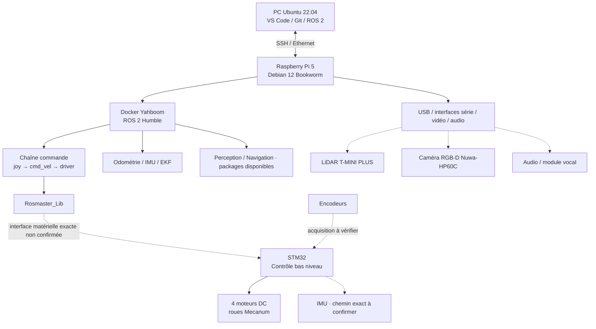
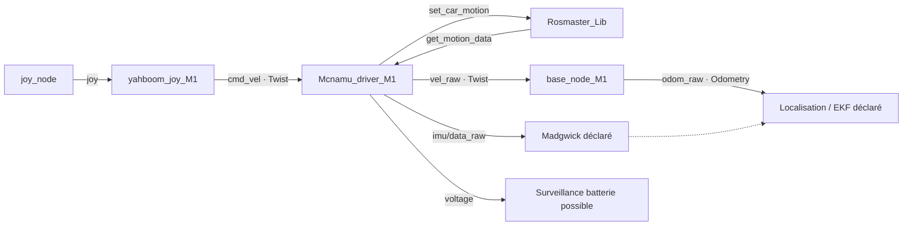

# R0B0T1CS LAB — P01
## ROSMASTER M1 · Technical Reference Manual

**Version :** 1.0 — Synthèse de découverte générale (R01–R08)  
**Plateforme :** Yahboom ROSMASTER M1 / Raspberry Pi 5 (8 Go) / STM32 / roues Mecanum  
**Méthode :** observations réalisées pendant le premier démarrage, commandes Linux, inspections statiques des sources Yahboom et diagnostics ponctuels en lecture seule.  
**Attention :** « identifié » ne signifie pas « testé en fonctionnement ». Ce manuel est une base de travail évolutive, pas une spécification constructeur ni une validation de sûreté.

## 1. Objectif et état initial

Premier démarrage effectué avec succès ; pilotage manuel réussi via la télécommande. Connexion du PC Ubuntu 22.04 au Raspberry Pi par **Ethernet direct**, avec Internet préservé sur le Wi-Fi domestique. Développement initial en niveau A (*Guided Learning*).

**Réseau de laboratoire établi :** PC `10.42.0.1/24` ↔ Raspberry Pi `10.42.0.2/24` via RJ45, SSH `pi@10.42.0.2`. Il s'agit de la configuration observée, non d'une obligation du robot.

## 2. Schéma d'architecture générale

**Légende :** flèches pleines = fonctions et liens identifiés par les sources ou les essais ; pointillés = affectations matérielles ou flux exacts **non démontrés**.

## 3. Résultats des huit recherches

| Recherche | Compréhension obtenue | État |
|---|---|---|
| **R01 — Raspberry Pi ↔ STM32** | ROS 2 `cmd_vel` → driver Python `Mcnamu_driver_M1` → `Rosmaster_Lib`; ports USB-série présents, attribution au STM32 inconnue. | ✅ Inventaire général |
| **R02 — ROS 2** | Bringup M1, commande, base mobile, perception, navigation, messages et interfaces ROS 2 identifiés dans les sources. | ✅ Inventaire statique |
| **R03 — Capteurs** | Ports USB-série, vidéo, audio, manette et packages capteurs recensés ; associations physiques partielles. | ✅ Inventaire général |
| **R04 — Mecanum** | Commandes `linear.x`, `linear.y`, `angular.z` transmises à la bibliothèque ; remontée des vitesses pour l'odométrie. | ✅ Architecture logicielle |
| **R05 — Odométrie / Fusion** | `vel_raw` → `odom_raw` ; publication IMU brute ; Madgwick et EKF déclarés. | ✅ Architecture déclarée |
| **R06 — Linux / Docker** | Debian 12, Docker, services hôte, container ROS 2 et mécanismes d'autostart possibles. | ✅ Inventaire passif |
| **R07 — Ressources** | CPU, RAM, température, stockage et Docker mesurés sur un instantané. | ✅ Baseline ponctuelle |
| **R08 — Sécurité** | Télémétrie batterie et chemin de commande identifiés ; watchdog et protections non démontrés. | ✅ Inventaire passif ; sécurité non validée |

## 4. Architecture ROS 2 utile pour les prochains projets

**Topics clés repérés dans les sources :** `cmd_vel`, `vel_raw`, `odom_raw`, `imu/data_raw`, `imu/mag`, `voltage`, `joy`. Les interfaces `scan`, `tf`, caméra RGB/profondeur et les fonctionnalités navigation sont présentes ou référencées dans d'autres packages, mais **leur fonctionnement en direct n'a pas été validé** par la campagne statique.

## 5. Capteurs et connexions

| Composant | Ce que nous savons | Limite |
|---|---|---|
| LiDAR T-MINI PLUS | Présent sur le robot ; packages LiDAR Yahboom inventoriés. | Port série attribué et flux `/scan` non testés. |
| Caméra RGB-D Nuwa-HP60C | Interface vidéo USB NOVATEK et driver `uvcvideo` observés. | Correspondance physique et flux profondeur non établis. |
| IMU 9 axes | `imu/data_raw` et `imu/mag` publiés dans le code ; filtre Madgwick déclaré. | Chemin d'acquisition et qualité des mesures non testés. |
| Encodeurs DC | Présence matérielle attendue sur les quatre moteurs ; vitesses disponibles via `get_motion_data`. | Origine précise de ces vitesses non confirmée. |
| OLED | Service `yahboom_oled.service` actif au moment du diagnostic. | Liaison électrique et protocole non caractérisés. |
| Module vocal | Périphérique C-Media USB audio et packages vocaux recensés. | Association physique exacte et fonctionnement non validés. |
| Télécommande | Récepteur USB DragonRise détecté ; pilotage manuel réussi lors du premier démarrage. | Chaîne ROS 2 exacte de cette séance non instrumentée. |

**Interfaces série :** premier diagnostic : CP2102 et WCH ; inventaire R03 : **3** convertisseurs USB-série (un CP2102, deux WCH CH340). Les numéros `/dev/ttyUSB*` ne constituent pas des identifiants persistants.

## 6. Logiciel et démarrage

- **Hôte :** Debian 12 Bookworm, noyau `6.12.25+rpt-rpi-2712`, architecture `aarch64`.
- **Docker :** version 28.2.2 ; image Yahboom `192.168.2.51:5000/ros-humble-m1:1.1.1` ; un container actif observé (`youthful_matsumoto` lors des derniers diagnostics) ; réseau Docker en mode `host`.
- **Services observés :** `docker`, `containerd`, `ssh`, `NetworkManager`, `wayvnc`, `yahboom_oled`, `jupyter`, `ollama` (selon relevé R06).
- **Démarrage :** certains fichiers `start_handle.desktop` et `start_servo.desktop` ont été repérés. Leurs actions et le démarrage automatique des Nodes n'ont pas été entièrement vérifiés. La politique Docker `restart=no` ne suffit pas à exclure une relance via d'autres mécanismes.
- **Launch M1 :** déclare notamment `Mcnamu_driver_M1`, `base_node_M1`, `robot_state_publisher`, `joint_state_publisher`, `imu_filter_madgwick`, l'EKF et les Nodes de télécommande.

## 7. Baseline de ressources R07

| Mesure ponctuelle | Valeur |
|---|---:|
| CPU (échantillon 1 s) | 1,5 % |
| Température CPU | 46,85 °C |
| RAM disponible | ≈ 7,00 Gio sur 7,88 Gio |
| Charge système (1 / 5 / 15 min) | 0,63 / 0,61 / 0,56 |
| Partition système `/` | 70,01 Gio |
| Espace disponible sur `/` | 12,21 Gio |
| Occupation `/` | 78,2 % |
| RAM container Docker | Non exploitable : `0B / 0B` dans la sortie collectée |

**À noter :** une microSD nominale de 128 Go est installée, mais le diagnostic `df` ne mesure qu'une partition système d'environ 70 Gio. La table de partitions et la destination de l'espace restant ne sont **pas** établies. Aucune opération de redimensionnement ou de nettoyage n'est autorisée sans une vérification séparée.

## 8. Sécurité et fiabilité

- **Confirmé dans le code :** lecture et publication de la tension batterie (`voltage`), réception de commandes `cmd_vel`, transmission via `set_car_motion`, lecture de la manette via `joy`.
- **Non confirmé :** stop automatique sur perte de commande, watchdog STM32, arbitrage de plusieurs sources `cmd_vel`, seuil matériel de sous-tension, arrêt d'urgence indépendant.
- **Essais physiques :** garder les quatre roues hors sol lors des premiers tests moteurs, contrôle humain et arrêt d'alimentation accessible. Ne pas confondre arrêt ROS 2 et arrêt d'urgence du système.
- **Observation à conserver :** dans `base_node_M1.cpp`, la vitesse latérale d'`odom_raw.twist.twist.linear.y` est écrasée par `0.0` alors qu'elle est employée pour intégrer la position. À examiner lors du projet d'odométrie, sans modification du logiciel constructeur pendant P01.

## 9. Anomalies et travaux différés

| Priorité | Sujet | Suite proposée |
|---|---|---|
| Haute | Horloge du Raspberry Pi réglée à une date de juillet 2026, fuseau `Asia/Shanghai`, synchronisation incorrecte | Corriger fuseau et synchronisation NTP avant les mesures ROS 2 horodatées. |
| Haute | Watchdog / arrêt sur perte de commande non vérifiés | Établir une procédure de test dédiée et sécurisée avant essais autonomes. |
| Moyenne | Stockage racine à 78,2 %, taille de partition inférieure à la capacité microSD annoncée | Vérifier `lsblk`, table des partitions et consommation Docker sans rien modifier. |
| Moyenne | Attribution réelle des ports USB-série et flux capteurs | Confirmer au premier projet expérimental de chaque capteur. |
| Moyenne | Vitesse latérale `/odom_raw` remise à zéro dans le code | Étudier avec l'odométrie et la Sensor Fusion. |
| Faible | Fréquences ROS 2 et graphe de Nodes non mesurés | Mesurer une fois les Nodes lancés avec sécurité maîtrisée. |

## 10. Matrice de validation finale P01

| Exigence | Statut | Justification |
|---|---|---|
| Inspection et batterie | ✅ Observation initiale | Inspection visuelle déclarée OK ; tension batterie mesurée à 12,5 V. |
| First Boot | ✅ Test initial | Robot démarré ; pilotage manuel réalisé. |
| Connexion réseau & SSH | ✅ Testée | Ethernet direct, `ping`, SSH opérationnels. |
| Linux / Docker / ROS 2 | ✅ Découverte | Système hôte, container et outils ROS 2 identifiés. |
| Inventaire des composants / capteurs | ✅ Statique | Périphériques et packages recensés, correspondances partielles. |
| Pilotage, odométrie, fusion | ✅ Architecture déclarée | Drivers et Launch Files examinés ; pas de mesures dynamiques ROS 2. |
| Performance de référence | ✅ Ponctuelle | Instantané CPU/RAM/température/stockage R07. |
| Sécurité opérationnelle complète | ⏳ Non validée | Tests de watchdog, perte de communication, arrêt d'urgence et protections non réalisés. |

**Bilan :** **P01 — découverte générale terminée** ; certaines validations dynamiques et les protections de sécurité restent explicitement ouvertes. Ce manuel ne remplace pas une procédure de mise en service sécurisée avant tout nouveau test moteur.

## 11. Documents sources et traçabilité

- `R01_RaspberryPi_STM32_Communication_v0_3.md` — inspection driver et base mobile.
- `R02_ROS2_Architecture.md` — architecture des Nodes, Topics et Launch Files.
- `R03_Sensors_Architecture.md` — inventaire des capteurs et périphériques.
- `R04_Mecanum_Motor_Architecture.md` — chaîne de motorisation.
- `R05_Odometry_Sensor_Fusion_Architecture.md` — odométrie, filtre IMU et EKF.
- `R06_Linux_Docker_Startup_Architecture.md` — Linux, containers et services.
- `R07_Performance_Resources_Baseline.md` — mesures de ressources.
- `R08_Safety_Reliability_Architecture.md` — inspection de sécurité.

Les archives originales `R01` à `R08` contiennent les éléments de preuve. Les horodatages basés sur l'horloge du Raspberry Pi sont erronés et ne doivent pas être utilisés pour dater les événements réels.

## 12. Réutilisation dans GitHub

Emplacement conseillé : `code/docs/P01/` dans le dépôt `SuperPolakJ/R0B0T1CS-ROSMASTER-M1` (dépôt Git à la racine, documents techniques sous `code/`). Les documents sont en Markdown avec diagrammes Mermaid ; ils peuvent être consultés directement dans GitHub.
