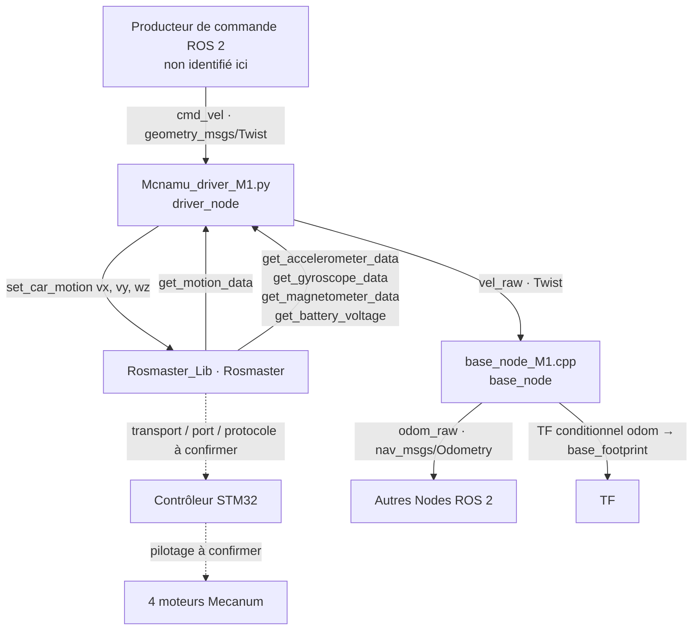

# R0B0T1CS LAB — R01 · Raspberry Pi ↔ STM32

**Rapport technique intermédiaire v0.3**  
**Plateforme :** Yahboom ROSMASTER M1 / Raspberry Pi 5 / ROS 2 Humble (Docker)  
**Éléments examinés :** `Mcnamu_driver_M1.py` (6 699 octets), `base_node_M1.cpp` (6 490 octets) et `manifest.json` de l'archive `R01_M1_driver_sources_20260701_221145.zip`.  
**Méthode :** lecture statique du code source ; aucun test dynamique réalisé dans cette analyse.

## 1. Synthèse

- **Confirmé par le code :** `Mcnamu_driver_M1.py` importe `Rosmaster` depuis `Rosmaster_Lib`, crée `Rosmaster()`, puis appelle `set_car_type(10)` pour le type M1 (lignes 11, 23–35).
- **Confirmé :** commandes souscrites `cmd_vel` (`geometry_msgs/Twist`, QoS profondeur 1), `RGBLight` (`Int32`), `Buzzer` (`Bool`), `Servo` (`ServoControl`) (lignes 56–60).
- **Confirmé :** commandes `linear.x`, `linear.y`, `angular.z` transmises sans conversion apparente à `set_car_motion(vx, vy, angular)` (lignes 76–86). Unités exactes non confirmées.
- **Confirmé :** données publiées `edition`, `voltage`, `vel_raw`, `imu/data_raw`, `imu/mag` ; publication par timer nominal **10 Hz** (lignes 62–74, 115–176). Le publisher `joint_states` est déclaré mais non utilisé dans ce fichier.
- **Confirmé :** `base_node_M1.cpp` souscrit `vel_raw` et publie `odom_raw` (`nav_msgs/Odometry`), avec intégration des vitesses planaires et diffusion conditionnelle de TF `odom → base_footprint` (lignes 75–76, 79–157).
- **Anomalie confirmée dans la source :** `odom.twist.twist.linear.y` est affecté avec `linear_velocity_y_`, puis écrasé par `0.0` (lignes 125–128). Le champ de vitesse latérale publiée est donc nul, même lorsque l'intégration de position utilise `linear_velocity_y_` (lignes 94–99).
- **Non établi :** port physique du STM32, baud rate, protocole binaire, checksum, correspondance CP2102/CH340, nature des mesures de vitesse (encodeurs ou autre), sécurité watchdog du contrôleur.

## 2. Schéma de la chaîne de commande



**Important :** les flèches en pointillés décrivent des hypothèses matérielles plausibles, pas des connexions prouvées par ces deux fichiers.

## 3. Interfaces ROS 2 déclarées

| Node / composant | Sens | Topic | Type | Source |
|---|---|---|---|---|
| `driver_node` (Python) | Subscribe | `cmd_vel` | `geometry_msgs/Twist` | lignes 56–57 |
| `driver_node` | Subscribe | `RGBLight` | `std_msgs/Int32` | ligne 58 |
| `driver_node` | Subscribe | `Buzzer` | `std_msgs/Bool` | ligne 59 |
| `driver_node` | Subscribe | `Servo` | `yahboomcar_msgs/ServoControl` | ligne 60 |
| `driver_node` | Publish | `edition` | `std_msgs/String` | ligne 63, 176 |
| `driver_node` | Publish | `voltage` | `std_msgs/Float32` | lignes 64, 175 |
| `driver_node` | Publish | `joint_states` | `sensor_msgs/JointState` | déclaration ligne 65 ; pas de publication trouvée dans ce fichier |
| `driver_node` | Publish | `vel_raw` | `geometry_msgs/Twist` | lignes 66, 164–167 |
| `driver_node` | Publish | `imu/data_raw` | `sensor_msgs/Imu` | lignes 67, 147–154, 173 |
| `driver_node` | Publish | `imu/mag` | `sensor_msgs/MagneticField` | lignes 68, 156–160, 174 |
| `base_node` (C++) | Subscribe | `vel_raw` | `geometry_msgs/Twist` | ligne 75 |
| `base_node` | Publish | `odom_raw` | `nav_msgs/Odometry` | lignes 76, 110–137 |

Les noms sont relatifs dans les sources : ils deviennent généralement des noms `/...` à la racine en l'absence de namespace ou remapping. Le graphe actif n'a pas encore été mesuré.

## 4. Calcul d'odométrie

Avec `v_x`, `v_y` dans le repère du robot, `θ` son orientation et `Δt` l'intervalle de temps :

\[
\Delta x=(v_x\cos\theta-v_y\sin\theta)\Delta t
\]
\[
\Delta y=(v_x\sin\theta+v_y\cos\theta)\Delta t
\]
\[
\Delta\theta=\omega_z\Delta t
\]

Le code intègre les valeurs par addition à `x_pos_`, `y_pos_`, `heading_` (lignes 94–99), puis construit la pose et le quaternion correspondants. Il n'y a pas de calibration de glissement ou de propagation d'incertitude élaborée dans ces fichiers.

### Point de vigilance R01-ISSUE-001 — vitesse latérale perdue dans le message

```cpp
odom.twist.twist.linear.y = linear_velocity_y_;
odom.twist.twist.linear.y = 0.0; // écrase la valeur précédente
```

La pose conserve l'effet de `v_y`, mais le champ `twist.linear.y` de `odom_raw` est forcé à zéro. **Ne pas corriger dans le code fournisseur sans validation et sans tests de régression.**

### Autres points à valider

- `vel_dt_ = (curren_time - last_vel_time_).seconds()` sans initialisation temporelle explicite visible avant le premier message (lignes 49, 83–90) : examiner le comportement initial.
- Covariances fixes (`0.001`, `0.0001`) sans mesure expérimentale associée (lignes 121–123, 133–135).
- Inversions de signe de l'accéléromètre sur les axes y et z (lignes 149–151) : vérifier conventions de repère et calibration.
- `set_car_motion` reçoit les commandes sans limitation apparente malgré les paramètres `xlinear_limit`, `ylinear_limit`, `angular_limit` déclarés (lignes 46–54, 82–86) : chercher les garde-fous dans `Rosmaster_Lib` et la firmware.
- Aucune orientation `imu.orientation` renseignée dans ce driver ; le message IMU brut contient l'accélération et la vitesse angulaire (lignes 147–154).

## 5. État des preuves

| Question | Statut | Preuve / limite |
|---|---|---|
| Quel composant reçoit `cmd_vel` ? | Confirmé (source) | `Mcnamu_driver_M1.py` 57, 76–86 |
| Comment le driver adresse-t-il le hardware ? | Confirmé au niveau API | `Rosmaster_Lib`, `set_car_motion`, diverses fonctions `get_*` |
| Quel port et quel débit série utilise-t-il ? | Non déterminé | Implémentation absente de l'archive |
| Comment arrive l'odométrie ? | Confirmé (source) | `vel_raw` → `base_node` → `odom_raw` |
| Les vitesses proviennent-elles des encodeurs ? | Non déterminé | `get_motion_data()` ne révèle pas sa source interne |
| Les Nodes ont-ils été lancés et mesurés ? | Non | Inspection statique uniquement |
| Comment le STM32 prévient-il les mouvements incontrôlés ? | Non déterminé | Code firmware et bibliothèque à inspecter |

## 6. Prochaine investigation prioritaire

**R01.05 — Localiser et lire `Rosmaster_Lib` sans l'importer ni ouvrir de périphérique.** Une fois localisée, inspecter : `serial.Serial(...)`, port par défaut, baud rate, construction et vérification des trames, commandes `set_car_motion`, décodage `get_motion_data` et éventuel watchdog.

## 7. Consignes de sécurité

- Garder les quatre roues dégagées du sol durant toute validation fonctionnelle.
- Ne pas publier sur `cmd_vel`, ne pas appeler `set_car_motion`, ne pas ouvrir de port série dans cette phase.
- Ne pas modifier le code fournisseur ou les paramètres du contrôleur avant d'avoir documenté les risques.
- En cas de test dynamique ultérieur : prévoir un arrêt immédiat et vérifier l'état des programmes de télécommande automatiques.

---

**Conclusion :** chaîne ROS 2 et odométrie documentées ; interface physique et protocole STM32 toujours à découvrir. Rapport intermédiaire, non un certificat de validation matériel.
