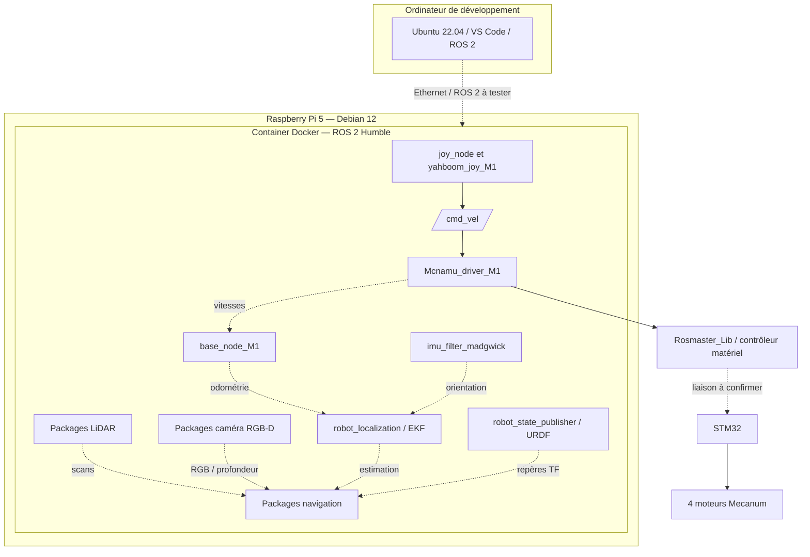

# R0B0T1CS LAB — P01 / R02
## Architecture ROS 2 du Yahboom ROSMASTER M1

**Version :** 1.0 — découverte générale  
**Source :** `R02_ros2_overview_20260701_222956.zip` (`R02_overview.json`, `R02_summary.md`), et inspection antérieure du fichier `yahboomcar_bringup_M1_launch.py` et des drivers du projet.  
**Méthode :** analyse statique en lecture seule ; aucun Node lancé, aucun mouvement commandé.  
**Statut :** inventaire logiciel établi ; fonctionnement opérationnel à valider.

## 1. Vue d'ensemble

Le Raspberry Pi 5 exécute Debian 12 et un environnement ROS 2 Humble dans un container Docker Yahboom. Les packages ROS 2 sont organisés par fonctions : contrôle, base mobile/odométrie, perception et navigation.

**Lecture du schéma :** les composants nommés sont présents dans les sources ; les flèches pointillées décrivent des flux fonctionnels attendus, pas des connexions ROS 2 toutes vérifiées à l'exécution.

## 2. Blocs fonctionnels

| Bloc | Composants identifiés | Rôle général |
|---|---|---|
| Pilotage | `joy`, `yahboomcar_ctrl`, `Mcnamu_driver_M1` | Convertir les ordres de commande en actions de la base mobile |
| Base mobile | `yahboomcar_base_node` | Exploiter les vitesses et calculer l'odométrie |
| Orientation et fusion | `imu_filter_madgwick`, `robot_localization` (EKF) | Filtrer l'orientation et fusionner les estimations |
| Modèle du robot | `yahboomcar_description`, `robot_state_publisher`, `joint_state_publisher` | Décrire le robot et publier les repères de coordonnées |
| Perception | `yahboomcar_laser`, `yahboomcar_astra`, `yahboomcar_depth` | Traiter les observations LiDAR et caméra |
| Navigation | `yahboomcar_nav` | Fournir des Launch Files pour localisation, cartographie et navigation |

## 3. Démarrage M1

Fichier identifié : `yahboomcar_bringup/launch/yahboomcar_bringup_M1_launch.py`.

- **Inclus dans le `LaunchDescription` fourni :** `joint_state_publisher` (ou variante GUI suivant le paramètre), `robot_state_publisher`, `Mcnamu_driver_M1`, `base_node_M1`, `imu_filter_madgwick_node`, le Launch EKF, `yahboom_joy_M1` et `joy_node`.
- **Défini mais non inclus dans le retour final du Launch File examiné :** `rviz2`. Sa présence dans le code ne signifie pas qu'il démarre avec ce Launch File.
- Le diagnostic R02 recense **39 fichiers Launch** dans huit packages ciblés, dont **26** dans `yahboomcar_nav`. Cela documente des possibilités de lancement, pas leur bon fonctionnement.

## 4. Topics intéressants

| Topic | Rôle | Niveau de preuve |
|---|---|---|
| `/cmd_vel` | Commande de vitesse | Confirmé dans les drivers examinés auparavant |
| `/vel_raw` | Vitesse remontée par le driver | Confirmé dans les drivers précédents |
| `/odom_raw` | Odométrie calculée | Confirmé dans les drivers précédents |
| `/imu/data_raw` | Mesures IMU | Confirmé dans le driver précédent |
| `/imu/data` | Orientation filtrée / donnée IMU utilisée | Référence trouvée dans les sources R02 |
| `/scan` | Données LiDAR | Référence trouvée dans les sources R02 |
| `/tf`, `/tf_static` | Transformations de repères | Références trouvées dans les sources R02 |
| `/ascamera_hp60c/camera_publisher/rgb0/image` | Image couleur | Référence trouvée dans les sources R02 |
| `/ascamera_hp60c/camera_publisher/depth0/image_raw` | Image de profondeur | Référence trouvée dans les sources R02 |

**Limite :** la recherche de R02 détecte des chaînes de caractères qui ressemblent à des Topics, dont certaines sont des chemins ou des URL (p. ex. `/www`, noms de Launch). Elles ne doivent pas être interprétées comme des Topics actifs.

## 5. Ce qui est confirmé / reste à vérifier

**Confirmé par l'inventaire statique :**
- Présence des huit packages ciblés.
- Présence du Launch M1 et de déclarations de Nodes.
- Présence de nombreux fichiers de lancement pour la navigation et la cartographie.

**À vérifier expérimentalement :**
- Quels Nodes et Topics sont réellement actifs lors d'un Bringup contrôlé.
- Correspondance exacte Publisher → Topic → Subscriber et fréquences réelles.
- Disponibilité des flux LiDAR et caméra RGB-D.
- Communication ROS 2 entre PC et Raspberry Pi.

**Reporté à d'autres projets :** protocoles bas niveau STM32, cinématique détaillée, QoS, EKF, SLAM et navigation autonome.

## 6. Conclusion de R02

L'architecture ROS 2 du ROSMASTER M1 est **identifiée au niveau global**. Les fonctions principales sont réparties entre le pilotage, l'odométrie/fusion, la perception et la navigation. R02 peut être clôturée au niveau « découverte statique » ; une validation dynamique non motrice pourra être planifiée ultérieurement selon les conditions de sécurité.

**Aucune anomalie d'exécution n'est déductible de ce seul inventaire.**
