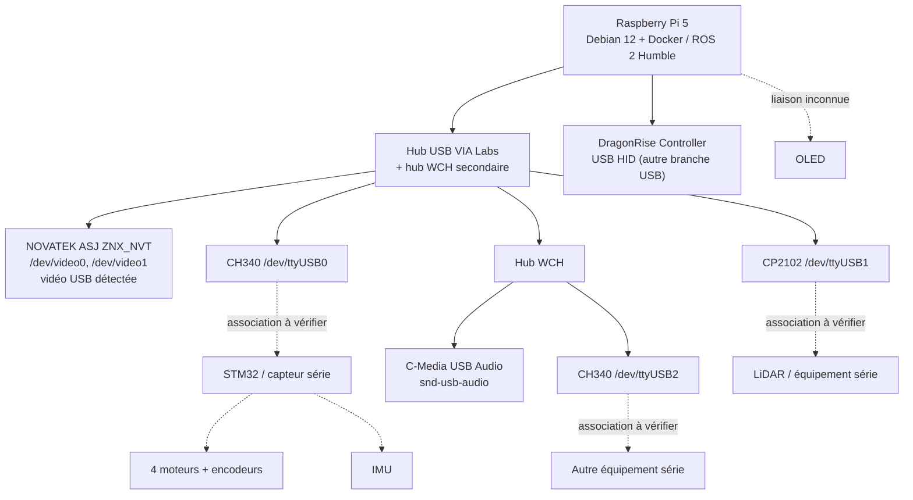

# R0B0T1CS LAB — P01 / R03
## Inventaire matériel des capteurs et périphériques — v1.0

**Plateforme :** Yahboom ROSMASTER M1 — Raspberry Pi 5 (8 Go) / STM32  
**Source primaire :** `R03_sensor_inventory_20260701_225950.zip` (`R03_inventory.json`, `R03_summary.md`)  
**Méthode :** inspection passive de Linux, de l'arbre USB et des répertoires de packages Yahboom dans Docker.  
**Portée :** cartographie générale, pas de test fonctionnel des capteurs.

## 1. Synthèse

- **Confirmé sous Linux :** trois convertisseurs USB-série (deux WCH CH340, un Silicon Labs CP2102), un équipement vidéo USB NOVATEK, un périphérique audio USB C-Media et un contrôleur HID DragonRise.
- **Confirmé dans les sources Yahboom :** packages dédiés à la base mobile, au LiDAR, à la caméra/profondeur, à la vision, à la télécommande et à la voix.
- **Non confirmé :** correspondance entre les ports série et le STM32/LiDAR, chemin matériel des mesures IMU/encodeurs, connexion OLED, disponibilité du flux de profondeur et fonctionnement réel des capteurs.

## 2. Schéma fonctionnel (les correspondances en pointillés sont des hypothèses)

**À lire avec prudence :** les branches USB sont observées ; les liens pointillés vers STM32, LiDAR, IMU et OLED ne sont **pas établis** par l'inventaire.

## 3. Périphériques USB et interfaces

| Équipement Linux | Identifiant | Interface identifiée | Certitude |
|---|---|---|---|
| WCH CH340 | `1a86:7523` | `/dev/ttyUSB0` | Détection confirmée ; rôle inconnu |
| Silicon Labs CP2102 | `10c4:ea60` | `/dev/ttyUSB1` | Détection confirmée ; rôle inconnu |
| WCH CH340 | `1a86:7522` | `/dev/ttyUSB2` | Détection confirmée ; rôle inconnu |
| NOVATEK ASJ ZNX_NVT | `3482:6723` | `/dev/video0`, `/dev/video1` (`uvcvideo`) | Vidéo USB confirmée ; caméra exacte et profondeur non validées |
| C-Media USB Audio Device | `0d8c:0012` | Pilote `snd-usb-audio` | Audio USB confirmé ; association module vocal non validée |
| DragonRise Controller | `0079:181c` | HID (`usbhid`) | Contrôleur USB confirmé |
| VIA Labs | `2109:2817` | Hub USB 2.0 | Confirmé |
| WCH | `1a86:8091` | Hub USB additionnel | Confirmé |
| VIA Labs Billboard | `2109:8817` | Interface Billboard | Présence confirmée ; fonction pertinente inconnue |

### Identifiants série persistants

- `usb-Silicon_Labs_CP2102_USB_to_UART_Bridge_Controller_0001-if00-port0` → `/dev/ttyUSB1`
- `usb-1a86_USB_Serial-if00-port0` → `/dev/ttyUSB2`
- Les chemins `/dev/serial/by-path/` distinguent également les trois branches USB observées.

**Attention :** `/dev/ttyUSB*` peut être renuméroté au redémarrage. La correspondance ci-dessus est propre à la session d'inventaire.

## 4. Cartographie par fonction

| Capteur/périphérique | Rôle général | Traces constatées | État de validation |
|---|---|---|---|
| LiDAR T-MINI PLUS | Mesurer les distances dans un plan | `yahboomcar_laser`, `laserscan_to_point_publisher`, ports série disponibles | Connexion précise et flux non validés |
| Nuwa-HP60C RGB-D | Images couleur + profondeur | NOVATEK UVC, `yahboomcar_astra`, `yahboomcar_depth`, `yahboomcar_vision` | Périphérique vidéo détecté ; association au modèle et profondeur non validées |
| IMU 9 axes | Mesurer accélérations, rotations et éventuellement champ magnétique | `imu_filter_param.yaml`, code ROS étudié en R01 | Liaison physique et mesures non validées |
| Encodeurs moteurs | Mesurer rotation et vitesse des roues | Code de contrôle/odométrie étudié en R01 | Remontée des données non testée |
| OLED | Affichage local | Matériel annoncé dans l'inventaire utilisateur | Interface inconnue |
| Module vocal | Capturer/restituer des interactions audio | C-Media USB Audio, packages vocaux Yahboom | Rôle USB exact non confirmé |
| Télécommande | Entrées utilisateur | DragonRise USB HID ; essai de pilotage réussi précédemment | Détection + essai global confirmés |

## 5. Packages sources repérés dans ce diagnostic

`laserscan_to_point_publisher`, `yahboomcar_astra`, `yahboomcar_base_node`, `yahboomcar_bringup`, `yahboomcar_ctrl`, `yahboomcar_depth`, `yahboomcar_description`, `yahboomcar_laser`, `yahboomcar_vision`, `yahboomcar_voice_ctrl`, `yahboomcar_voice_ctrl_depth`.

Présence d'un `package.xml` dans ces 11 répertoires. La présence d'un package n'est pas un essai du capteur.

## 6. Constats et suites

1. **Architecture générale suffisamment établie pour clôturer R03 au niveau P01.** Trois ports série USB et les périphériques vidéo/audio/HID sont visibles.
2. **Ne pas figer les numéros de ports USB dans les futurs programmes.** Privilégier les identifiants persistants et confirmer les associations au moment d'un test ciblé.
3. **Les fonctions RGB-D, LiDAR, IMU et encodeurs devront être validées** lors de futurs projets par des flux réels, des Topics ROS et des mesures.
4. **Horloge du robot à corriger ultérieurement :** la date du rapport est `2026-07-01T22:59:50`, incohérente avec la date de cette campagne (novembre 2026).
5. **Aucune action matérielle active** n'a été effectuée pendant ce diagnostic ; aucun capteur ou port série n'a été ouvert.

## 7. Statut

**R03 — Inventaire statique : VALIDÉ (niveau découverte générale).**  
**Validation fonctionnelle des capteurs : EN ATTENTE**, hors périmètre de cette étape.
