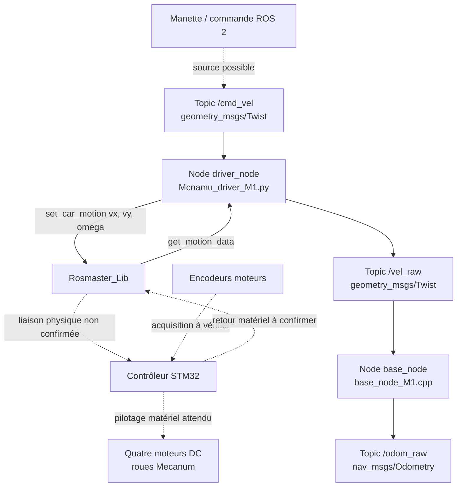

# R0B0T1CS LAB — P01 / R04
## Architecture générale de la motorisation Mecanum

**Robot :** Yahboom ROSMASTER M1 · **Niveau :** découverte générale · **État :** validé au niveau de l'inventaire statique

### 1. But
Comprendre le trajet d'une commande ROS 2 jusqu'à la bibliothèque matérielle Yahboom et la remontée des vitesses vers l'odométrie. Les protocoles, le firmware et les tests de mouvement sont volontairement hors périmètre à ce stade.

### 2. Schéma fonctionnel

**Légende :** flèches pleines = liaison explicitement présente dans les sources fournies ; flèches pointillées = liaison matérielle attendue mais non démontrée par les trois fichiers analysés. Les composants de commande manette sont déclarés dans le Launch File mais la liaison effective entre manette et `/cmd_vel` n'a pas été testée ici.

### 3. Principaux composants

| Élément | Rôle | Niveau de preuve |
|---|---|---|
| `Mcnamu_driver_M1.py` | Lit `/cmd_vel`, transmet les trois composantes de mouvement à `Rosmaster_Lib`; publie `/vel_raw` | Confirmé dans le code |
| `Rosmaster_Lib` | Interface logicielle vers le matériel | Import et méthodes confirmés ; implémentation non examinée |
| STM32 | Contrôle embarqué des moteurs | Architecture attendue, interface exacte non vérifiée par R04 |
| 4 moteurs DC + roues Mecanum | Mouvement avant/arrière, latéral et rotation | Matériel annoncé ; pas de caractérisation en R04 |
| Encodeurs | Mesures de rotation des roues | Matériel annoncé ; origine de `/vel_raw` non démontrée |
| `base_node_M1.cpp` | Intègre les vitesses de `/vel_raw` et publie `/odom_raw` | Confirmé dans le code |

### 4. Messages importants

| Interface ROS 2 | Type | Usage |
|---|---|---|
| `/cmd_vel` | `geometry_msgs/msg/Twist` | Entrée de commande : `linear.x`, `linear.y`, `angular.z` |
| `/vel_raw` | `geometry_msgs/msg/Twist` | Vitesses remontées par la bibliothèque |
| `/odom_raw` | `nav_msgs/msg/Odometry` | Pose et vitesse estimées par intégration |

Les noms sans `/` initial dans le code sont relatifs au namespace ROS 2. Ici, `/cmd_vel` etc. représentent les noms attendus dans la configuration par défaut sans namespace.

### 5. Mouvements possibles

- **Longitudinal :** avancer / reculer — `linear.x`.
- **Latéral :** translation de côté — `linear.y`.
- **Rotation :** pivoter autour de l'axe vertical — `angular.z`.
- **Combiné :** translations diagonales et mouvements simultanés.

Les unités transmises au matériel et les performances ne sont pas validées ici ; les détails de cinématique et de régulation sont reportés aux projets dédiés.

### 6. Points de vigilance

- **Incohérence dans `/odom_raw` :** le fichier `base_node_M1.cpp`, lignes 125–127, attribue `linear_velocity_y_` à `odom.twist.twist.linear.y` puis remplace immédiatement cette valeur par `0.0`. La position reste intégrée à partir de `linear_velocity_y_` (lignes 94–99). À examiner lors du projet odométrie.
- **Pas d'arrêt automatique démontré :** l'absence de publication de `/cmd_vel` ne démontre pas que les moteurs s'arrêtent après un délai. Tester ultérieurement les mécanismes de sécurité sans supposition.
- **Pas d'essai physique :** R04 repose sur une analyse statique ; aucun moteur ni encodeur n'a été testé à cette étape.
- **Source de vitesse incertaine :** `get_motion_data()` est confirmé, mais son calcul interne n'est pas connu.
- **Entrée point de code :** `Mcnamu_driver_M1.py` définit `main()`, tandis que son appel direct sous `if __name__ == '__main__'` est commenté ; le mode de lancement installé peut différer (entry point Python). Le Launch File déclare l'exécutable `Mcnamu_driver_M1`.

### 7. Traçabilité des sources

Archive transmise : `R04_motor_overview_20260701_231026.zip`.

- `sources/Mcnamu_driver_M1.py` : lignes 11, 29–35, 56–74, 76–86, 114–176.
- `sources/base_node_M1.cpp` : lignes 32–76, 79–99, 110–155.
- `sources/yahboomcar_bringup_M1_launch.py` : lignes 77–90, 105–127.

### 8. Validation de R04

| Critère | Résultat |
|---|---|
| Chaîne logicielle ROS 2 → bibliothèque matérielle | ✅ Identifiée |
| Topics de commande et feedback | ✅ Identifiés dans le code |
| Principe des déplacements Mecanum | ✅ Compris au niveau fonctionnel |
| Liaison physique exacte vers STM32 | ⏳ Hors périmètre actuel |
| Origine et résolution des données encodeurs | ⏳ À examiner ultérieurement |
| Mesures de déplacement et sécurité moteur | ⏳ À tester dans un projet dédié |

**Conclusion : R04 validée pour la découverte générale de P01.**
