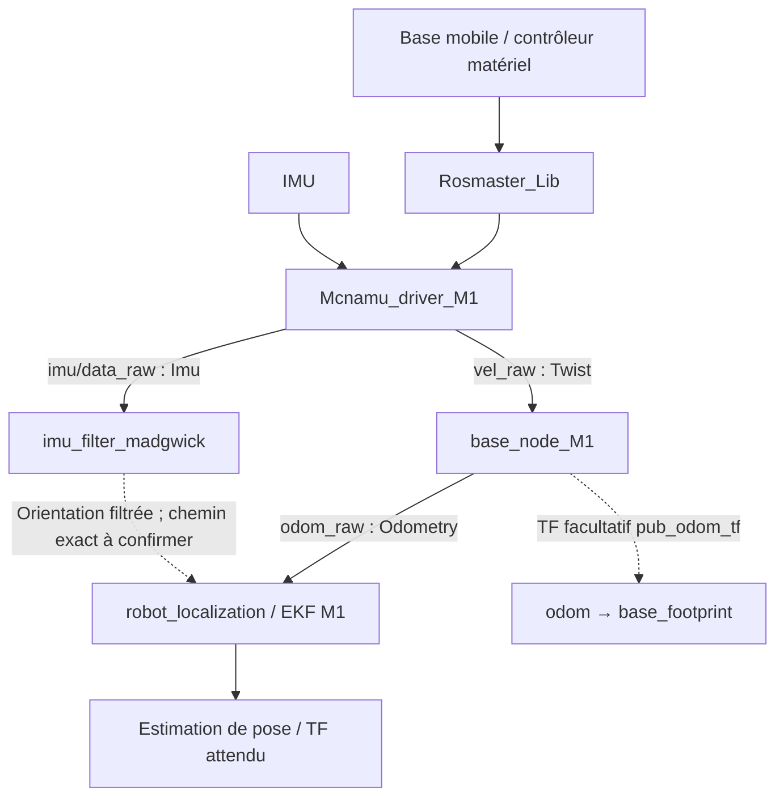

# R0B0T1CS LAB — P01 / R05
## Odometry & Sensor Fusion — Architecture générale

**Robot :** Yahboom ROSMASTER M1 — Raspberry Pi 5 / Docker / ROS 2 Humble  
**Version :** 1.0 — Inventaire statique  
**Source primaire :** `R05_odometry_fusion_overview_20260701_231833.zip`  
**Périmètre :** vue fonctionnelle ; aucun test de déplacement, aucune validation des Topics en fonctionnement.

## 1. Synthèse

Le code du ROSMASTER M1 organise l'estimation du mouvement autour de deux sources :
- **Vitesses de la base** provenant de `Mcnamu_driver_M1.py`, publiées sur `vel_raw` ; `base_node_M1.cpp` les intègre puis publie `odom_raw`.
- **IMU** : mesures d'accélération et de vitesse angulaire publiées par le driver sur `imu/data_raw`. Le Launch M1 déclare un filtre `imu_filter_madgwick` et inclut un Launch EKF de `robot_localization`.

L'origine exacte des vitesses dans le contrôleur matériel (notamment contribution des encodeurs) n'est pas confirmée par les fichiers analysés. La configuration exacte de l'EKF du M1 n'a pas été collectée.

## 2. Architecture fonctionnelle



**Légende :** trait continu = chemin déclaré dans les sources collectées ou composant explicitement inclus ; pointillé = liaison ou comportement à confirmer. La flèche `odom_raw` vers EKF décrit le fonctionnement prévu, mais l'input effectif de l'EKF M1 n'a pas été vérifié.

## 3. Composants et Topics

| Élément | Fonction | Niveau de preuve |
|---|---|---|
| `Mcnamu_driver_M1.py` | Lit les vitesses et les données IMU via la bibliothèque Yahboom | Confirmé dans le code |
| `vel_raw` (`geometry_msgs/Twist`) | Transporte les vitesses vers le Node d'odométrie | Confirmé dans le code |
| `base_node_M1.cpp` | Intègre les vitesses pour calculer `x`, `y` et `yaw` | Confirmé dans le code |
| `odom_raw` (`nav_msgs/Odometry`) | Publie l'estimation de déplacement | Confirmé dans le code |
| `imu/data_raw` (`sensor_msgs/Imu`) | Données inertielles | Confirmé dans le code |
| `imu/mag` (`sensor_msgs/MagneticField`) | Données magnétométriques | Confirmé dans le code |
| `imu_filter_madgwick` | Filtrage de l'orientation | Déclaré dans le Launch |
| `ekf_M1_launch.py` (`robot_localization`) | Système de fusion d'état | Inclus dans le Launch, contenu non collecté |
| TF `odom → base_footprint` | Transformée de position de la base | Conditionnée par `pub_odom_tf` ; désactivée par défaut dans ce Bringup |

## 4. Configuration observée

`imu_filter_param.yaml` :

```yaml
imu_filter_madgwick:
  ros__parameters:
    fixed_frame: "base_link"
    use_mag: false
    publish_tf: false
    world_frame: "enu"
    orientation_stddev: 0.1
```

- Le filtre Madgwick est déclaré, mais **n'utilise pas le magnétomètre** (`use_mag: false`).
- Il ne publie pas directement de TF selon cette configuration (`publish_tf: false`).
- Le Bringup définit `pub_odom_tf=false` par défaut pour `base_node_M1` ; le TF devrait être géré ailleurs, mais il faut le confirmer lors d'un test actif.
- Le driver Python configure un timer à 0,1 s (10 Hz nominal, non mesuré).
- Quatre fichiers EKF supplémentaires ont été collectés dans des dossiers **multi-robots**. Leur configuration (notamment `odom_raw`, `imu/data_ekf`, 30 Hz) **ne doit pas être attribuée directement au M1** sans inspection de `ekf_M1_launch.py`.

## 5. Repères ROS 2

- `odom` : repère d'odométrie locale.
- `base_footprint` : repère de référence au sol.
- `base_link` : repère du corps du robot.
- `imu_link` : repère des mesures IMU.

La cohérence de l'arbre TF complet reste à mesurer en fonctionnement.

## 6. Points de vigilance, sans modification pour P01

- **Vitesse latérale dans `odom_raw` :** `base_node_M1.cpp` affecte `linear.y` puis la remet immédiatement à `0.0`. La pose intègre néanmoins la vitesse latérale. À revisiter pendant un projet de validation odométrique.
- **Source des mesures de vitesse :** contribution exacte des encodeurs non démontrée par les fichiers collectés.
- **EKF M1 :** fichier Launch exact non collecté ; entrées, sorties et paramètres spécifiques à vérifier ultérieurement.
- **Horloge :** date/fuseau du Raspberry Pi semblent incorrects, sujet important pour les mesures horodatées.

## 7. Matrice de validation

| Critère P01 / R05 | Statut |
|---|---|
| Chaîne logicielle des vitesses vers l'odométrie | ✅ Confirmée par code |
| Existence du driver IMU et du filtre Madgwick | ✅ Confirmée par code / Launch |
| Existence d'un Launch EKF M1 | ✅ Confirmée par inclusion |
| Paramètres exacts de l'EKF M1 | ⏳ Non collectés |
| Qualité de l'odométrie et de l'orientation en fonctionnement | ⏳ Non mesurée |
| Chaîne TF complète en fonctionnement | ⏳ Non mesurée |

**Décision P01 :** R05 validée au niveau **découverte générale**. Les détails mathématiques et tests expérimentaux sont reportés à un projet consacré à l'odométrie et à la Sensor Fusion.

## 8. Provenance

Les conclusions ci-dessus proviennent des fichiers suivants, extraits de l'archive R05 : `sources/M1_bringup_launch.py`, `sources/imu_filter_param.yaml`, `sources/base_node_M1.cpp`, `sources/Mcnamu_driver_M1.py`, et `R05_summary.md`. Les quatre `additional_ekf_*.txt` sont des exemples de configuration multi-robots, pas la configuration M1 établie.
