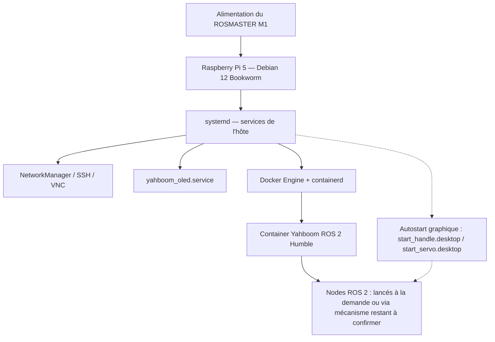

# R0B0T1CS LAB — P01 / R06
## Architecture Linux, Docker et démarrage — ROSMASTER M1

**Version :** 1.0 · **État :** découverte générale validée · **Source :** `R06_linux_docker_startup_20260701_233034.zip` (`R06_report.json`, `R06_summary.md`)  
**Méthode :** inspection passive sur Raspberry Pi ; aucune modification de configuration ni lancement de Node.

## 1. Vue d'ensemble



**Lecture :** les traits pleins désignent des dépendances ou composants identifiés ; les pointillés désignent une relation de lancement **possible, non démontrée**. Le démarrage de Linux et des services ne prouve pas le démarrage automatique de Nodes ROS 2.

## 2. Résultats confirmés

| Couche | Observation | Sens |
|---|---|---|
| Machine | Debian GNU/Linux **12 (Bookworm)** | OS hôte du Raspberry Pi |
| Noyau | `6.12.25+rpt-rpi-2712`, `aarch64` | Linux pour Raspberry Pi, architecture 64 bits |
| Docker | `28.2.2` | Exécution de l'environnement robotique conteneurisé |
| Containers | **18** inventoriés, **1 actif** pendant le diagnostic | Plusieurs sessions/containers conservés |
| Container actif | `youthful_matsumoto` | Image `192.168.2.51:5000/ros-humble-m1:1.1.1` |
| Réseau Docker | `host` | Le container partage l'espace réseau de l'hôte |
| Politique de redémarrage des containers | `no` pour les 18 entrées inventoriées | Docker ne redémarre pas automatiquement **ces containers** selon leur politique propre |
| Volumes du container actif | `/dev/myserial`, `/dev/input`, `/root/share`, `/tmp/.X11-unix` | Accès exposé aux interfaces et aux échanges graphiques/fichiers ; usages exacts à confirmer |
| Services actifs | `docker`, `containerd`, `NetworkManager`, `ssh`, `wayvnc`, `yahboom_oled`, `jupyter`, `ollama` | Fonctions systèmes disponibles, indépendamment des Nodes ROS 2 |
| Autostart graphique | `start_handle.desktop`, `start_servo.desktop` | Mécanismes de lancement déclarés pour une session graphique ; contenu et exécution non étudiés |

**Ne pas confondre :** un service `enabled` est configuré pour être lancé sous certaines conditions ; un service `active (running)` était effectivement en cours d'exécution lors de la collecte. Le rapport confirme notamment ces deux états pour `docker.service`, `ssh.service`, `wayvnc.service` et `yahboom_oled.service`.

## 3. Architecture fonctionnelle simplifiée

```text
MISE SOUS TENSION
    │
    ▼
Raspberry Pi 5
    │  Debian 12 + systemd
    ├── Réseau : NetworkManager ── Ethernet / Wi-Fi
    ├── Accès : SSH / VNC
    ├── Affichage : yahboom_oled.service
    ├── Services supplémentaires : Jupyter / Ollama
    └── Docker Engine
            │
            ▼
      Container Yahboom
      (ROS 2 Humble)
            │
            └── Drivers / Nodes / Launch Files ROS 2
                (démarrage effectif à vérifier)
```

## 4. Points de vigilance

### Horloge système : non synchronisée
Le rapport indique au moment de la collecte :

- Date locale **1er juillet 2026 à 23:30**, fuseau **Asia/Shanghai (UTC+08)**.
- `System clock synchronized: no` malgré `NTP service: active`.
- Valeur de l'horloge RTC incohérente (`1970-01-01`).

La date de référence de notre travail est le **24 novembre 2026** en Belgique. Il faudra synchroniser l'horloge avant de collecter des données horodatées en ROS 2 ; aucun changement n'a été effectué par le diagnostic.

### Plusieurs containers historiques
17 containers étaient arrêtés ; certains affichent les codes de sortie `0`, `129`, `137` ou `255`. **Ces codes ne prouvent pas à eux seuls une panne actuelle.** Aucun nettoyage automatique n'est recommandé à ce stade.

### Démarrage automatique : distinction essentielle
- **Confirmé :** Docker, SSH, OLED et plusieurs autres services Linux sont actifs.
- **Confirmé :** les containers inventoriés ont une politique Docker `restart=no`.
- **Possible :** un script externe, un raccourci d'autostart graphique ou une action de l'utilisateur lance un container.
- **Non confirmé :** quel mécanisme lance `youthful_matsumoto`, et quels Nodes ROS 2 sont réellement démarrés automatiquement.

## 5. Bilan de validation R06

| Critère | État |
|---|---|
| Linux et architecture du Raspberry Pi identifiés | ✅ Confirmé |
| Docker et container ROS 2 identifiés | ✅ Confirmé |
| Principaux services du système identifiés | ✅ Confirmé |
| Modes réseau et accès matériels du container observés | ✅ Confirmé |
| Séquence complète de lancement automatique des Nodes | ⏳ Non vérifiée |
| Horloge correctement synchronisée | ❌ Non, correction future nécessaire |

**Conclusion :** la couche Linux assure les services généraux (réseau, accès distant, OLED, etc.). Docker fournit l'environnement ROS 2 ; cependant, **le démarrage de Docker, celui d'un container et celui des Nodes sont trois événements distincts**. L'inventaire actuel permet de comprendre l'organisation générale sans modifier le système.

## 6. Suite du programme

- **R07 — Performances et ressources** : CPU, RAM, stockage, températures et charge système (mesures passives).
- **R08 — Sécurité et fiabilité** : mécanismes d'arrêt, garde-fous et points de validation pour les essais moteurs.

---
*Document construit à partir du diagnostic R06 fourni par l'utilisateur ; interprétations non directement attestées explicitement signalées.*
