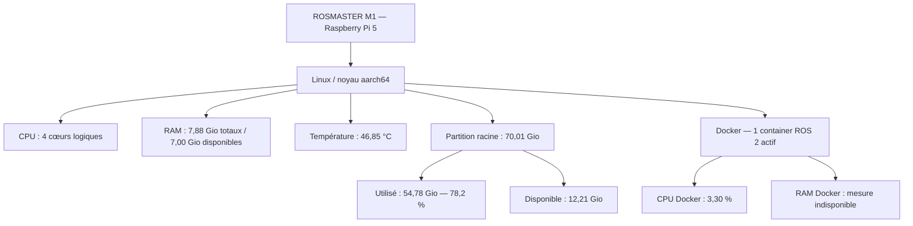

# R0B0T1CS LAB — P01 / R07
## Performance & Resources Baseline — ROSMASTER M1

**Version :** 1.0  
**Source :** `R07_performance_baseline_20260701_233828.zip` (`R07_baseline.json` et `R07_summary.md`)  
**Méthode :** mesures ponctuelles, lecture seule ; utilisation CPU observée sur 1 seconde ; aucun benchmark ni test sous charge.  
**Datation :** le Raspberry Pi signale `2026-07-01T23:38:27+08:00` ; son horloge/fuseau ont été identifiés comme incorrects. Ne pas utiliser cet horodatage comme référence temporelle fiable.

## 1. Mesures enregistrées

| Indicateur | Mesure | Interprétation |
|---|---:|---|
| Architecture / noyau | `aarch64` / `6.12.25+rpt-rpi-2712` | Linux Raspberry Pi 64 bits |
| Cœurs logiques | 4 | Capacité de calcul disponible |
| CPU, échantillon 1 seconde | 1,5 % | Faible charge à l'instant de la mesure |
| Load Average (1 / 5 / 15 min) | 0,63 / 0,61 / 0,56 | Pas de saturation apparente à cet instant |
| Température CPU | 46,85 °C | Pas d'anomalie thermique apparente au repos |
| RAM totale | 8 257 200 KiB ≈ 7,88 Gio | RAM vue par Linux |
| RAM disponible (`MemAvailable`) | 7 343 312 KiB ≈ 7,00 Gio | Marge mémoire estimée par Linux |
| RAM libre (`MemFree`) | 6 541 312 KiB ≈ 6,24 Gio | Différent de « disponible » (caches récupérables) |
| Swap totale / libre | 1 021 136 / 1 021 136 KiB | Environ 0,97 Gio, intégralement libre |
| Partition `/` | 70,01 Gio | Taille du **système de fichiers mesuré**, pas de la carte entière |
| Espace utilisé `/` | 54,78 Gio (78,2 %) | Point de vigilance |
| Espace disponible `/` | 12,21 Gio | Peut limiter les futurs enregistrements |
| `/home/pi` | Identique à `/` | Même système de fichiers, ne pas additionner les volumes |
| Uptime | 6 289 secondes | ≈ 1 h 44 min 49 s |

**Remarque stockage :** utilisé + disponible n'est pas nécessairement égal à la taille totale d'un système de fichiers Linux, notamment à cause de blocs réservés ou de la représentation par les outils. Le diagnostic ne révèle pas la table des partitions de la microSD annoncée à 128 Go.

## 2. Docker

| Indicateur | Résultat |
|---|---|
| Container actif | `youthful_matsumoto` |
| Image | `192.168.2.51:5000/ros-humble-m1:1.1.1` |
| Statut | `Up 2 hours` |
| CPU (`docker stats --no-stream`) | 3,30 % |
| RAM reportée par Docker | `0B / 0B` (0,00 %) |

La mesure Docker de RAM n'est **pas exploitable** : elle ne démontre pas une consommation mémoire nulle. Le pourcentage CPU Docker et celui du système n'utilisent pas nécessairement la même base de calcul ; ne pas les additionner ni les comparer directement.

## 3. Architecture synthétique des ressources

## 4. Observations et limites

- ✅ **Confirmé :** mesures ci-dessus enregistrées par le script R07.
- ✅ **Encourageant :** CPU et RAM présentent une bonne marge dans les conditions observées ; température non alarmante.
- ⚠️ **À vérifier :** partitionnement complet de la carte microSD 128 Go et utilisation de l'espace (`/` à 78,2 %).
- ⚠️ **À vérifier :** mécanisme de reporting mémoire Docker (`0B / 0B`).
- ⚠️ **À corriger ultérieurement :** synchronisation de l'horloge et fuseau horaire du Raspberry Pi.
- ⏳ **Non testé :** CPU, RAM, température et espace disque pendant SLAM, navigation, capture RGB-D ou enregistrement rosbag.

## 5. Conclusion

**R07 — PASS pour un inventaire initial des ressources.** Le robot ne présente pas de signe de saturation CPU, mémoire ou thermique au moment de la mesure. **La principale réserve concerne le stockage** : la partition racine de 70,01 Gio est déjà utilisée à 78,2 %, tandis que la capacité annoncée de la microSD est 128 Go. Il faut inspecter le partitionnement avant de conclure que l'espace de la carte est perdu ou insuffisant.

**Prochaine recherche P01 :** R08 — Safety & Reliability. Une vérification séparée du stockage est recommandée avant les projets générant des volumes importants de données.
