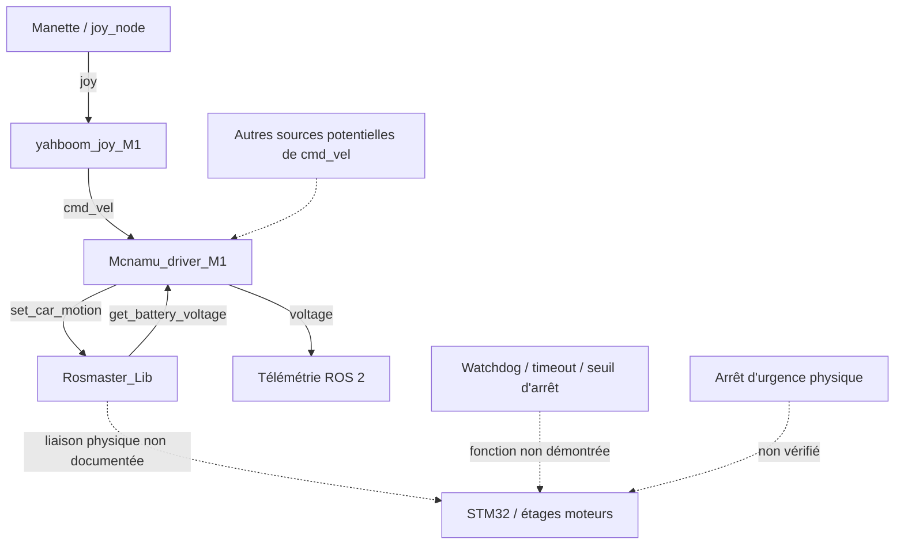

# R0B0T1CS LAB — P01 / R08
## Sécurité & Fiabilité — Inventaire passif v1.0

**Robot :** Yahboom ROSMASTER M1 · Raspberry Pi 5 / STM32 · ROS 2 Humble dans Docker  
**Source :** `R08_safety_reliability_20260701_235110.zip` (`R08_overview.json`, `R08_summary.md`)  
**Méthode :** lecture seule d'extraits de code et vérification de quelques services Linux. Aucun essai de sécurité ou de mouvement.  
**Statut :** découverte logicielle réalisée ; **sécurité fonctionnelle non validée**.

## 1. Synthèse des preuves

| Fonction | Observation directement présente dans l'archive | Interprétation / état |
|---|---|---|
| Commande des mouvements | `Mcnamu_driver_M1.py`, ligne 57 : abonnement à `cmd_vel`; ligne 86 : `set_car_motion(vx, vy, angular)` | **Confirmé** : chemin logiciel de commande. Un arrêt sûr sur perte de commande n'est **pas** établi. |
| Télécommande | `yahboom_joy_M1.py`, ligne 45 : abonnement à `joy`; ligne 37 : publication de `cmd_vel` | **Confirmé** : commandes issues de la manette possibles. Priorité entre sources de commandes non évaluée. |
| Tension de batterie | Driver, ligne 134 : `get_battery_voltage()`; ligne 175 : publication du message sur `voltage` (publisher créé ligne 64) | **Confirmé** : télémétrie de tension disponible dans le code. Protection automatique de sous-tension **non démontrée**. |
| Exécution périodique | Driver, ligne 71 : timer de `0.1` seconde | **Confirmé** : minuterie de publication nominale à 10 Hz ; **pas une preuve de watchdog**. |
| Arrêt ROS 2 | `base_node_M1.cpp`, ligne 167 : `rclcpp::shutdown()` | **Confirmé** : arrêt de la couche logicielle ROS 2 ; aucun freinage ni coupure moteur démontré. |
| Services hôte | `docker`, `ssh`, `NetworkManager`, `yahboom_oled` : `active` | **Confirmé** au moment du diagnostic ; n'implique aucune fonction de sûreté. |
| Watchdog STM32 | Firmware STM32 non inspecté | **Non vérifié**. |
| Arrêt d'urgence matériel | Aucun essai ni examen électrique détaillé | **Non vérifié**. |
| Protection électrique batterie/moteurs | Schémas et protections non inspectés | **Non vérifié**. |

> Une absence de résultat dans la recherche par mots-clés **ne démontre pas l'absence de protection** : elle peut être implémentée dans `Rosmaster_Lib`, le firmware STM32, l'électronique ou d'autres logiciels non couverts par R08.

## 2. Schéma fonctionnel de surveillance et de commande

**Lecture :** flèches pleines = relations visibles dans les sources examinées ; pointillés = relation hypothétique ou non validée. Le diagramme n'est **pas** une chaîne de sécurité certifiée.

## 3. Risques et vérifications futures

| Sujet | Risque à maîtriser | Projet / validation futurs |
|---|---|---|
| Perte de commandes | Continuité inattendue d'un déplacement | Vérifier la réaction à l'absence de `cmd_vel`, robot sur support, arrêt immédiat disponible. |
| Sources multiples de `cmd_vel` | Commandes concurrentes | Examiner une stratégie d'arbitrage, de priorité et de timeout. |
| Batterie faible | Fonctionnement instable ou décharge excessive | Vérifier protections matérielles et seuils documentés, sans provoquer de décharge excessive. |
| Défaut logiciel / USB | Ordres périmés ou absence de retour | Examiner timeout du contrôleur et réaction sur perte de liaison. |
| Démarrage automatique | Mouvement non sollicité | Vérifier les programmes d'autostart avant toute expérimentation avec roues au sol. |
| Odométrie | Valeurs latérales publiées incohérentes | Vérifier `odom_raw.twist.twist.linear.y` lors d'un futur projet d'odométrie. |
| Horloge système | Logs et mesures mal horodatés | Corriger fuseau et synchronisation NTP avant les mesures temporelles. |
| Stockage | Manque de place pour logs / rosbag | Examiner le partitionnement et l'occupation avant les collectes volumineuses. |

## 4. Règles opérationnelles conservatoires

- Premiers essais moteurs : **quatre roues dégagées du sol**, support stable et zone dégagée.
- Ne pas lancer de commande de mouvement avant d'avoir défini une procédure d'arrêt accessible.
- Ne pas supposer que publier `cmd_vel = 0` est une fonction d'arrêt d'urgence indépendante.
- Ne pas débrancher des connecteurs électriques sous charge ; arrêter Linux proprement avant de couper l'alimentation habituelle lorsque la situation le permet.
- Ne pas tester volontairement une décharge profonde, un court-circuit ou un défaut électrique.
- Conserver l'image Yahboom d'origine et documenter les modifications avant d'essayer de corriger les comportements identifiés.

## 5. Critères de validation R08

- [x] Identifier les éléments logiciels de commande et la télémétrie batterie.
- [x] Recenser l'état de quatre services Linux importants.
- [x] Documenter les limites du diagnostic statique.
- [ ] Vérifier expérimentalement les réactions en cas de perte de commande (procédure de sécurité dédiée).
- [ ] Vérifier le firmware / les protections STM32.
- [ ] Vérifier l'arrêt d'urgence matériel et les protections électriques.

**Conclusion :** R08 est terminée au **niveau inventaire général de P01**. Cela ne vaut **ni homologation ni validation de sûreté** du robot.

## 6. Provenance et limites

Source primaire : `R08_overview.json`, horodatage interne `2026-07-01T23:51:10+08:00` (horloge du robot antérieurement reconnue incorrecte). Le diagnostic n'a inspecté que quatre fichiers sources ciblés, à l'aide de motifs de recherche, et quatre états de services. Il n'a pas ouvert de port série, n'a pas lancé de Node et n'a effectué aucun essai dynamique. Les observations sont limitées aux sources collectées à cette date.
